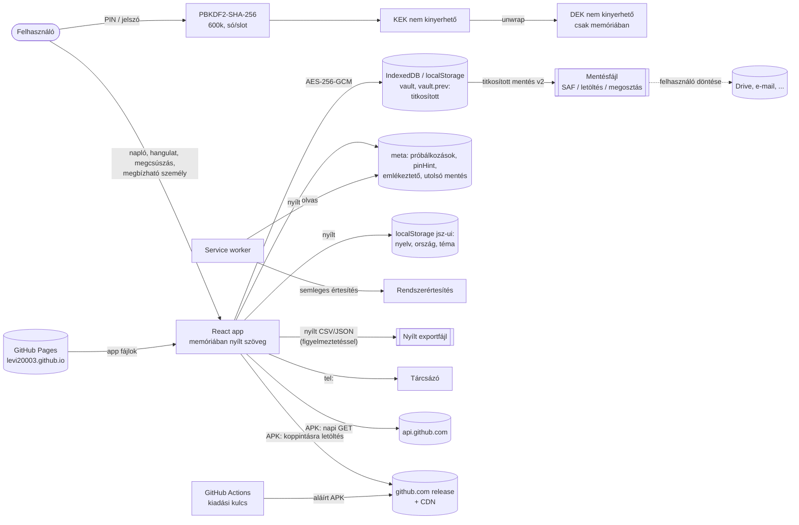

# Fenyegetésmodell és architektúra

> **Audit dátuma:** 2026-11-02 · **Vizsgált commit:** `220c066c283c22dbf3a5b16c9d1616d33a33d34c` · read-only előaudit · **nem független** (lásd `RISK-REGISTER.md` fejléc)

## 1. Architektúra röviden

| Réteg | Mi | Bizonyíték |
|---|---|---|
| Felület | React 19 PWA (Vite 8), azonos kód a weben és Android WebView-ban (Capacitor 8) | `package.json:24-36`, `capacitor.config.json` |
| Állapotgép | `INITIALIZING → FIRST_TIME_SETUP / LOCKED ⇄ UNLOCKED`, valamint `STORAGE_ERROR` | `src/auth/appAuth.js:13-20,105-116` |
| Titkosítás | Borítékos titkosítás: PBKDF2-SHA-256 → KEK → AES-GCM wrap → DEK → AES-GCM payload | `src/crypto/vault.js:1-10,115-207` |
| Tárolás | IndexedDB (`jozansag-szamlalo`/`kv`) → localStorage → memória; kulcsok: `vault`, `vault.prev`, `meta` | `src/storage/backends.js:53-54,226-258`; `src/storage/store.js:18-20` |
| Offline | Service worker: csak a saját fájlokat cache-eli, csak a saját originre; a nyílt `meta`-ból emlékeztet | `src/sw/sw.template.js:20-44,77-94` |
| Natív (APK) | `JszFilesPlugin` (mentés SAF-fal, megosztás, FLAG_SECURE, aláírás-lenyomat, pause), `JszUpdaterPlugin` (frissítő) | `android/app/src/main/java/io/github/levi20003/sober/*.java` |
| Kiadás | GitHub Actions: teszt, build, aláírás, `android-latest` release; GitHub Pages | `.github/workflows/android.yml`, `pages.yml` |

## 2. Adatfolyam

**Mi hagyhatja el az eszközt?**
1. A titkosított mentésfájl, a felhasználó döntésére.
2. A nyílt CSV/JSON export, figyelmeztetés után (`src/components/screens/Settings.jsx:241-247`).
3. A vágólapra másolt helyreállító kód.
4. Hálózati metaadat (IP-cím, időpont) a GitHub felé: Pages-letöltés, APK-frissítéskeresés és -letöltés, visszajelző link.
5. `tel:` hívások.

Az app saját szervere nem létezik; a weben a CSP `connect-src 'none'` (`index.html:7`), az APK-ban csak `https://api.github.com` (`scripts/android-csp.mjs:6`).

**Hiba, összeomlás, megszakítás esetén:**
- Atomikus írás: IndexedDB-tranzakció (`backends.js:116-121`), localStorage-on visszagörgetés.
- `vault.prev`: visszaállítás az előző állapotra (`store.js:254-260`).
- Tárolóhibánál nem kínál új naplót a meglévő fölé (`backends.js:251-252`; `appAuth.js` `STORAGE_ERROR`).
- Újabb séma esetén UNSUPPORTED, és nem ír semmit (`store.js:197-200`).
- Ismert rés: SEC-05.

## 3. Védett értékek

| Érték | Érzékenység |
|---|---|
| Napló-tartalom (szerhasználat, megcsúszás, hangulat, jegyzet, levél) | GDPR 9. cikk szerinti különleges adat lehet |
| Megbízható személy neve és száma | harmadik fél személyes adata |
| PIN / jelszó, helyreállító kód | hozzáférési titok |
| Kiadási aláírókulcs (CI-titok) | a teljes felhasználói kör integritása |
| Segélyvonal-adatok helyessége | élet- és egészségvédelem |

## 4. Támadók és forgatókönyvek (STRIDE szerint)

| # | Támadó | Képesség | Forgatókönyv | Védelem | Maradék kockázat |
|---|---|---|---|---|---|
| T1 | Kíváncsi családtag | feloldott telefon rövid ideig | belenéz a naplóba | automatikus zárolás 5 perc (`appAuth.js:29`), zárolás háttérbe kerüléskor (`:204-224`) | feladatváltó-előnézet (SEC-06) |
| T2 | Telefontolvaj | zárolt telefon | PIN-próbálgatás a felületen | korlát 5 hiba után (`store.js:22-44`) | – |
| T3 | Kriminalisztikai kinyerés, root, rosszindulatú app root joggal | a WebView-adatkönyvtár másolata | offline PIN-törés | PBKDF2 600k, AES-GCM | **4 jegyű PIN percek alatt (SEC-01)**; pinHint (SEC-07) |
| T4 | Aki megkapja a mentésfájlt (Drive, e-mail) | a fájl | offline törés | mint T3 | SEC-01 |
| T5 | Rosszindulatú mentésfájl | import | DoS, prototype pollution, sérült adat | méret- és mélységkorlát, tiltott kulcsok (`src/lib/safeJson.js`), ellenőrzőösszeg, validáció (`backupFile.js`), iterációs plafon (`vault.js:157`) | alacsony |
| T6 | Ugyanazon origin másik oldala (`levi20003.github.io/*`) | JS a közös originben | a titkosított rekord kinyerése vagy törlése | nincs | **SEC-18** |
| T7 | Clickjacking (webes változat) | keretbe ágyazás | rákattintatás | csak a meta CSP (ott a `frame-ancestors` hatástalan) | **SEC-17** |
| T8 | GitHub-fiók vagy token kompromittálása, hibás automatikus módosítás | push a `main`-re | aláírt, rosszindulatú frissítés | aláírás-egyezés (ugyanaz a kulcs, ezért itt nem véd) | **SEC-02** |
| T9 | Hálózati támadó | MITM | hamis frissítés | HTTPS, SHA-256, aláírás-ellenőrzés (`JszUpdaterPlugin.java:62-104`) | alacsony |
| T10 | Felhőmentés vagy eszközátvitel | Android backup | a napló kimásolása | `allowBackup=false`, `fullBackupContent=false`, minden domain kizárva | OEM-eszközök: NOT VERIFIED |
| T11 | XSS / injektálás | rosszindulatú szöveg a naplóban vagy importban | szkriptfuttatás | React escaping, nincs `dangerouslySetInnerHTML`/`innerHTML` (keresés: 0 találat), CSP, Trusted Types (web) | alacsony; az APK-ban nincs Trusted Types (`android-csp.mjs:13`) |
| T12 | Hibás krízis-tartalom | – | rossz szám, elérhetetlen felület | tesztek, statikus tartalék, 90 napos figyelmeztetés | próbahívás hiányzik (CLIN-05) |

## 5. Bizalmi határok
- A böngésző/WebView és az OS: megbízható (rootolt eszköz: nem).
- GitHub: megbízható kiszolgáló a kódnak és a frissítésnek; a kompromittálódása kritikus (T8).
- A felhasználó által választott tárhely (Drive stb.): nem megbízható; csak titkosított adat kerüljön oda (a nyílt export a felhasználó felelőssége, figyelmeztetéssel).
